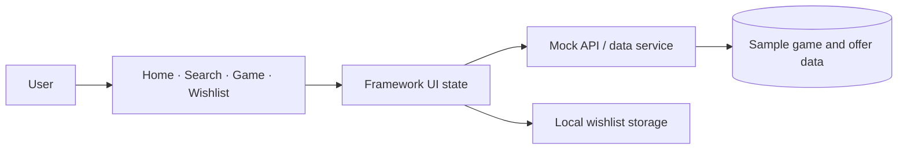
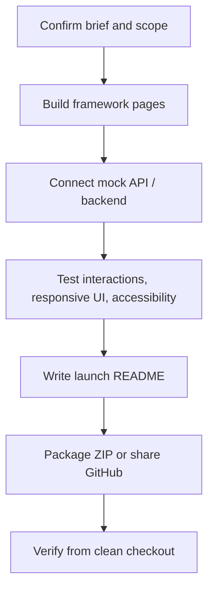

# PlayRadar · Phase 3 field report

> **Purpose:** translate the supplied course brief into a practical checklist, show what the repository already proves, and give the team a low-risk route to a submit-ready deliverable.
>
> **Status snapshot:** 14 November 2026 · updated after implementation and clean-archive validation.

## Executive summary

### The short version

- 🎨 **The design/prototype work remains available:** four linked HTML reference screens, responsive-oriented styling, real Steam data for 14 games, and a polished presentation.
- ✅ **The Phase 3 implementation is in place:** a Next.js app with Home, Search, Game Details, and Wishlist pages, mock REST endpoints, and a setup guide.
- 🧪 **The app builds and its core data flows have been browser-checked:** search, currency switching, wishlist persistence, mock API responses, and a narrow viewport were exercised.
- 📦 **A separate Phase 3 ZIP is prepared and clean-checked:** dependencies install from the archive, tests/build/data export pass, and the packaged app responds over HTTP.
- ⚠️ **Final sign-off still needs team/instructor actions:** confirm the brief mismatch and deadline, finish browser/accessibility/performance checks, and push or share the final version.

## First: a naming mismatch to resolve

The supplied file is named **`Projet_WEB_OBJ3.pdf`**, but its cover says **“PROJET WEB — OBJECTIF-02”**. Its content is the development-and-integration brief and the presentation’s final slide calls that next work “Objectif 03.” The PDF also says academic year **2025/2026**, while the repository README says **2026–2027**.

This report treats the PDF’s pages 2–9 as the requirements for the phase you mean by “Phase 3.” Confirm the official objective number, school year, deadline, and any separate rubric with your instructor before final submission; the supplied PDF does not give a deadline or detailed grading rubric.

## What the brief requires

The checklist below follows the supplied PDF (pages 3–9). “Required” means explicitly present in the brief, not an extra technical choice.

| Requirement | What you need to show |
|---|---|
| 🧰 Development setup (p. 3) | Use the necessary development tools, initialize the project with the chosen framework, collaborate through a shared Git repository, and keep a clear folder/naming structure. |
| 🖥️ Frontend integration (p. 4) | Turn the approved prototype into working pages, preserve the sitemap/design intent, provide navigation, and make the interface responsive across mobile, tablet, and desktop. |
| ⚙️ Core functionality (p. 5) | Implement the important user interactions (such as search, filters, forms, notifications, or other project-specific actions) and manage application state. Prioritize core needs before extras. |
| 🔌 Data source (p. 5) | Use **either** an existing REST API, **or** a minimal backend. The brief gives mocked data as an option; it does not demand production infrastructure. |
| 🤝 Team practice (p. 6) | Divide work, use clear Git commits/feature branches, test components before integration, document technical choices/dependencies, and track work collaboratively. |
| 🧪 Preview and quality (p. 7) | Check supported browsers, links/forms/interactions, performance, semantic structure, accessibility, and contrast. |
| 📦 Submission (p. 8) | Submit a **ZIP archive or GitHub link** containing a functional site with **at least 3–5 dynamic pages**, a frontend based on the chosen framework, a minimal backend or API simulation, and a short README explaining framework, features, and launch steps. The suggested archive name is `GroupeX_Projet_Web_Objectif3.zip`. |

### Minimum submission checklist

- [x] A working, navigable site with at least **3 pages**; the implementation carries forward **4**.
- [x] The chosen framework is actually used in the frontend: Next.js and React.
- [x] Core interactions work and page content is data-driven.
- [x] A mock REST API supplies the game catalogue; no real backend/database is claimed.
- [ ] Finish responsive and accessibility checks across representative browsers/devices.
- [x] README explains the framework, implemented features, and exact setup/run steps.
- [x] A Phase 3 ZIP contains the app and was verified from a clean extraction.

## Where PlayRadar stands today

The table records what can be verified from the current repository. “Partial” means useful groundwork exists, but the whole Phase 3 requirement still needs confirmation.

| Area | Status | Evidence / remaining work |
|---|---|---|
| Sitemap and page design | ✅ Strong groundwork | The presentation describes a 12-page sitemap and shows prototype flows and desktop/mobile screens. |
| Prototype screens | ✅ Present | `prototype/` contains Home, Search, Game, and Wishlist as four linked HTML pages. |
| Interactive behavior | ✅ Implemented and smoke-tested | Framework app supports catalogue search/filter/sort, EUR/DT switching, wishlist add/remove, and local target/alert controls. The alert is explicitly local/demo-only. |
| Data | 🟡 Partly real, partly simulated | Steam information is a dated snapshot for 14 games; other-store offers and price histories are simulated. |
| Framework frontend | ✅ Implemented | Next.js App Router with Home, Search, Game Details, and Wishlist; original prototype remains as reference. |
| Backend / simulated API | ✅ Mock API implemented | `GET /api/games` supports query filters/sorting and `GET /api/games/:id` returns a game or 404. Data comes from `data/games.json`. |
| Wishlist and alerts | 🟡 Local-only, disclosed | Wishlist/target/alert state persists in browser storage. There is no account sync or email delivery. |
| Responsive design | 🟡 Basic check passed | A 390px viewport had no horizontal document overflow and retained navigation. Tablet and full cross-browser checks remain. |
| Testing / accessibility / performance | 🟡 Partial | Three Node tests pass; production build succeeds; browser smoke checks cover search, currency, wishlist, and API responses. Accessibility and performance review remain. |
| README / launch procedure | ✅ Updated | Root README documents Node/npm setup, dev/build commands, features, API routes, and mock-data limitations. |
| Git / sharing | 🟡 Remote configured | Local `main` has an `origin` remote; teammate access and whether latest changes have been pushed are not verified. |
| Submission archive | ✅ Prepared and clean-checked | `livrables/Groupe9_Projet_Web_Objectif3.zip` includes the app, required assets, README, lockfile, tests, mock API data, and data-export sources. A clean extraction installed, tested, exported data, built, and served the app. |

### Overall assessment

**The core implementation and ZIP handoff are now in place.** Remaining work is submission sign-off: complete cross-browser/accessibility checks, confirm the official brief and deadline, and push or share the exact final version with the team/instructor.

## Suggested product scope

Keep the first release focused on the strongest existing user journey:

1. 🏠 **Home:** featured games, deals, upcoming titles, and search.
2. 🔎 **Search:** query and filter the game catalogue; open a result.
3. 🎮 **Game details:** compare offers, show price history/verdict, and add or remove a wishlist item.
4. ❤️ **Wishlist:** view saved games and edit/remove a target price or alert state.

Use the four current prototype pages as the design and content reference. For this phase, a “price alert” can be clearly labeled as a **demo/local alert** if it only runs in the browser. Do not promise email delivery without implementing and testing it.

### Recommended implementation choice

The Objective 02 presentation already proposes **Next.js/React** for the site, **Express** for a REST API, and **PostgreSQL** for storage. Reusing the documented choice keeps the project coherent, but those specific products are not mandated by the supplied Phase 3 brief.

**Implementation delivered:** the frontend uses Next.js/React and the app exposes a mock API with stable sample responses. This follows the brief’s “minimal backend or API simulation” alternative without introducing unnecessary infrastructure. Add Express/PostgreSQL only if the instructor or the team specifically requires a real backend.

> **Important:** the mock API/data layer is implemented. Wishlist state is still browser-local; this does not provide accounts or email alerts.

## Next steps: a practical procedure

### 1 · Confirm and organize

- [ ] Confirm with the instructor that this supplied PDF is the Phase 3 brief despite the “OBJECTIF-02” cover.
- [ ] Confirm the required school year, deadline, ZIP naming, and whether a mock API is acceptable.
- [ ] Agree as a team to keep the existing four-page scope and select the framework. The presentation’s proposal is Next.js/React.
- [ ] Confirm both teammates can access the shared GitHub repository.
- [ ] Create a Phase 3 branch and a short task board; keep commits focused and readable.

### 2 · Bootstrap the real app — complete

- [x] Create the framework application in a dedicated source folder; preserve `prototype/` as the visual reference.
- [x] Establish the shared layout, navigation, responsive tokens, and reusable game card/price components.
- [x] Implement the four screens: Home, Search, Game Details, and Wishlist.
- [x] Reuse existing typography, colors, images, and game data; clearly label simulated offers/history and local-only alerts.

### 3 · Connect data and implement the core journey — complete

- [x] Define a stable game/offer fixture and document which fields are real versus simulated.
- [x] Add a mock API/data-service boundary with collection and detail endpoints.
- [x] Implement search, filters, currency display, game details, and wishlist add/remove.
- [x] Label price alerts as demo/local-only; no real notification mechanism is claimed.
- [x] Verify search/API empty and missing-result behavior and wishlist persistence.

### 4 · Validate the result — in progress

- [x] Start the production app and verify it responds; build and tests pass.
- [x] Test Home, Search, Game Details, Wishlist, currency switching, search filters, and persistence in the integrated browser.
- [x] Check a narrow 390px viewport; no horizontal overflow was detected.
- [ ] Check current Chrome, Firefox, and Edge (plus Safari if available); note any untested browser honestly.
- [ ] Complete keyboard, accessibility, contrast, and broken-link/image review. The browser check confirmed representative local artwork paths load.
- [ ] Optimize oversized images and confirm the app remains usable when optional data is unavailable.
- [x] Record the automated and browser smoke-check results in this report.

### 5 · Document, package, and hand off — in progress

- [x] Update the root README with the framework, prerequisites, install/run commands, features, data/API approach, and known limitations.
- [x] Include the lockfile and required source/assets; exclude dependencies/build output and machine-specific files.
- [x] Create `livrables/Groupe9_Projet_Web_Objectif3.zip`.
- [x] Extract the archive into a clean folder, install dependencies, regenerate data, run tests/build, and verify the production site/API respond.
- [ ] Push the final branch/commit and verify the shared repository contains the exact version being submitted.

## Suggested team split

These are suggestions, not requirements from the PDF. The Objective 02 presentation already sketches Yessine on frontend and Ahmed on backend/data collection; keep that split only if it still fits your current availability.

| Workstream | Suggested owner | Pairing / acceptance check |
|---|---|---|
| Framework shell, responsive pages, navigation | Yessine (presentation’s proposed frontend lead) | Ahmed reviews routes and data needs; all four pages open and link correctly. |
| Mock API/data contract, optional backend, game data | Ahmed (presentation’s proposed backend lead) | Yessine integrates against the agreed contract; data source and mock limitations are documented. |
| Wishlist and end-to-end integration | Both | Add/remove survives refresh; UI shows accurate demo behavior; no unhandled errors. |
| Browser checks, README, final archive | Both | One teammate prepares; the other follows the README from a clean checkout and confirms the archive. |

## Suggested acceptance/demo checklist

Use this as the final rehearsal script:

1. Open the Home page and navigate to Search.
2. Search for a game and apply a filter; open a result.
3. Compare the displayed offers and explain which data is real versus simulated.
4. Add the game to the Wishlist, refresh, then edit/remove it.
5. Repeat the main journey on a mobile viewport.
6. Launch the project from the README in a clean checkout.
7. State any limitations clearly (for example: no real email, no account sync, mock prices).

## Source notes

- **Course brief:** `Projet_WEB_OBJ3.pdf`, pages 2–9. Page 8 is the source for the required submission format and minimum contents.
- **Repository status:** README, `prototype/` pages and scripts, `presentation/index.html`, Git branch/remote, and the existing archive were inspected for this report.
- **Phase 3 validation performed:** `npm test` (3 passing), `npm run build`, production server response, `/api/games` search response (200), missing-game API response (404), browser search/currency/wishlist smoke checks, and 390px viewport overflow check.
- **Clean archive validation:** `npm ci`, `npm test`, `npm run data:export`, and `npm run build` all passed from an extracted copy of the ZIP; Home, Game Details, and the filtered mock API returned HTTP 200.
- **Date/data caveat:** the repo README says Steam data was collected on 7 November 2026; those values should be refreshed or described as a dated snapshot before presenting them as current.
