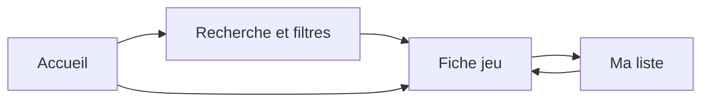
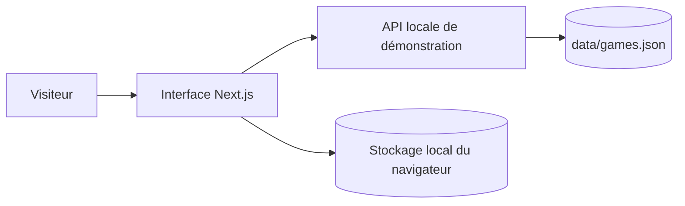

# 🎮 PlayRadar

> **Le bon jeu, au bon prix, au bon moment.**
>
> PlayRadar rassemble les informations utiles avant l’achat d’un jeu : offres, éditions, données clés et prix, avec un parcours simple pour rechercher, comparer et garder ses favoris.

**Projet Web · Groupe 9 · Sup’Com** · **Application actuelle :** Next.js / React · **Langue de l’interface :** français

---

## En un coup d’œil

| | |
|---|---|
| 🎯 **Pour qui ?** | Les joueurs qui veulent comparer avant d’acheter et suivre les jeux qui les intéressent. |
| 💡 **Le problème visé** | Les prix et informations d’un jeu sont dispersés entre plusieurs boutiques et pages. |
| 🧭 **La réponse PlayRadar** | Un même endroit pour explorer le catalogue, examiner une fiche et conserver une liste personnelle. |
| 🧪 **État du projet** | Démonstrateur fonctionnel. Certains prix et historiques sont simulés ; ce n’est pas encore un comparateur connecté en continu. |

## Comment le site est organisé



### 🏠 Accueil — `/`

Une porte d’entrée vers le catalogue : jeux mis en avant, offres de la démo, sorties à venir et accès direct à la recherche.

### 🔎 Recherche — `/search`

Le catalogue peut être parcouru avec une recherche textuelle et des filtres :

- plateforme ;
- prix maximum ;
- promotions ;
- jeux déjà sortis ou à venir ;
- ordre de tri.

Les résultats ouvrent la fiche correspondante. L’URL conserve les critères pour qu’une recherche filtrée puisse être partagée ou rouverte.

### 🎮 Fiche jeu — `/games/<id>`

Une page regroupe les informations disponibles sur le jeu : studio, éditeur, plateformes, classification, éditions, offres par boutique et description. Les jeux disposant de données d’historique affichent aussi un graphique de démonstration.

### ❤️ Ma liste — `/wishlist`

La liste permet d’ajouter/retirer un jeu, de définir une cible de prix et de mettre une alerte locale en pause ou en marche. Les données sont conservées dans le stockage du navigateur : elles ne suivent pas l’utilisateur sur un autre appareil.

---

## 🔍 Voir le site par soi-même

L’application Next.js doit être servie par Node.js. **Ne pas ouvrir `app/page.js` ou un fichier de l’application dans le navigateur** : le serveur gère les routes et l’API.

1. Installer **Node.js 20.9+** et npm.
2. Depuis le dossier racine du dépôt, ouvrir un terminal et exécuter :

   ```bash
   npm install
   npm run dev
   ```

3. Garder ce terminal ouvert. Ouvrir **http://localhost:3000** (ou l’adresse que Next.js affiche si le port est déjà utilisé).
4. Essayer le parcours ci-dessous :

   **Accueil → rechercher “Red Dead Redemption 2” → ouvrir sa fiche → ajouter à Ma liste → régler une cible → changer EUR/DT.**

### Ce qu’il faut observer

- 🔎 La recherche et les filtres mettent à jour les résultats sans recharger toute l’application.
- 🎮 La fiche détaille les offres, les éditions et les informations du jeu.
- ❤️ L’ajout à la liste est visible dans l’en-tête et survit à la navigation ou à un rechargement du même navigateur.
- 💱 Le bouton **€ / DT** adapte l’affichage des prix. Le taux de conversion est une approximation fixe pour la maquette.
- ⚠️ Les alertes ne sont pas des notifications réelles : aucun e-mail n’est envoyé.

Le serveur s’arrête lorsque l’on ferme le terminal. Pour relancer le site, reprendre `npm run dev`. Les liens internes ne fonctionneront plus tant qu’aucun serveur n’est lancé.

---

## ⚙️ Comment les données circulent



| Élément | Rôle |
|---|---|
| `app/` | Pages, composants partagés et routes API de Next.js. |
| `lib/games.js` | Recherche et filtrage du catalogue. |
| `data/games.json` | Fixture de 14 jeux consommée par l’application et l’API de démonstration. |
| `public/assets/` | Polices, styles, jaquettes et visuels réutilisés depuis le prototype. |
| `app/api/games/route.js` | `GET /api/games` : catalogue filtrable (`q`, `platform`, `genre`, `maxPrice`, `promos`, `sort`). |
| `app/api/games/[id]/route.js` | `GET /api/games/:id` : détail d’un jeu ou réponse 404 si l’identifiant est inconnu. |

Les jeux sont issus d’un relevé Steam effectué le **7 novembre 2026**. Les prix Steam sont identifiés dans la fiche ; les prix des autres boutiques et les historiques ne sont pas des mesures en direct. La liste et les réglages sont conservés localement, sans compte utilisateur ni base de données distante.

---

## ✅ Fonctionnalités disponibles maintenant

- Interface Next.js avec quatre parcours navigables.
- Recherche, filtres et tri du catalogue.
- Fiches de jeux avec prix, éditions et informations descriptives.
- Comparaison EUR/DT avec taux indicatif.
- Wishlist locale, cible de prix et état d’alerte local.
- API de démonstration pour lister/rechercher les jeux ou récupérer une fiche.
- Prototype de conception et présentation Objectif 02 conservés dans le dépôt.

## 🛣️ Pistes pour la suite — pas encore implémentées

Ces éléments prolongent la vision du prototype et le périmètre pédagogique. Ils ne sont **pas** des fonctions que l’application actuelle fournit déjà.

### Priorité 1 · Des prix réellement suivis

- Connecter plusieurs sources officielles plutôt que d’utiliser des offres de démonstration.
- Automatiser les relevés et enregistrer les historiques réels.
- Ajouter une base de données pour conserver jeux, boutiques, offres et dates de relevé.

### Priorité 2 · Des alertes utiles au quotidien

- Comptes utilisateurs et liste synchronisée entre appareils.
- Notifications réellement envoyées lorsqu’un prix passe sous la cible.
- Préférences de devise et de notification associées au compte.

### Priorité 3 · Compléter l’arborescence du prototype

- Pages dédiées aux promotions et au calendrier des sorties.
- Guide d’achat depuis la Tunisie.
- Connexion, profil et préférences.
- Actualités de jeux et enrichissement progressif des fiches.

La suite devra garder une distinction claire entre prix **mesurés**, données **estimées** et données **simulées**.

---

## 🧪 Vérification locale

Depuis la racine du projet :

```bash
npm test
npm run build
```

Pour servir ensuite la version de production, après le build :

```bash
npm run start
```

Les outils de génération de données Steam, de captures et de PDF se trouvent dans `tools/`. Pour la vue d’ensemble et les commandes rapides, revenir au [README](README.md).

## 📁 Livrables associés

- [Application Next.js — archive Objectif 03](livrables/Groupe9_Projet_Web_Objectif3.zip)
- [Présentation PDF — Objectif 02](livrables/Groupe9_Projet_Web_Objectif2.pdf)
- [Présentation animée](presentation/index.html)
- [Prototype HTML](prototype/index.html)
- [Rapport Phase 3 et checklist](PHASE-3-REPORT.md)

---

*Projet étudiant. Les marques, jaquettes et visuels de jeux restent la propriété de leurs ayants droit. Les données et prix de démonstration ne constituent pas une offre commerciale.*
